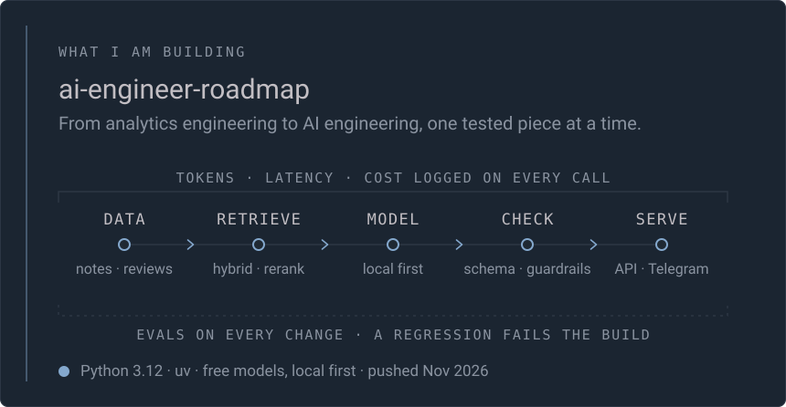
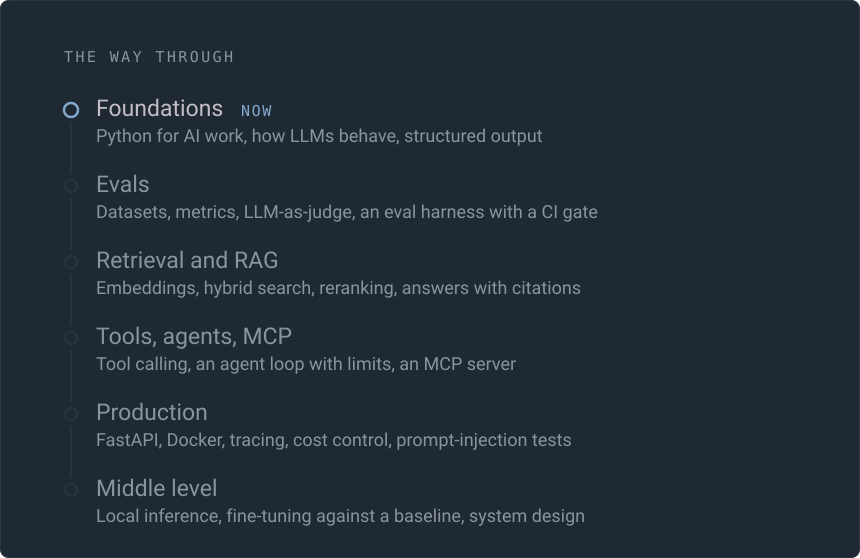
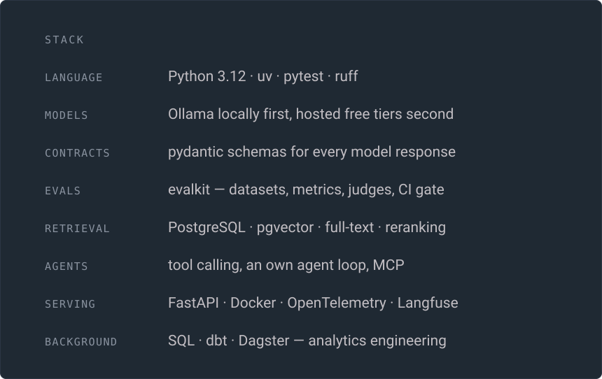
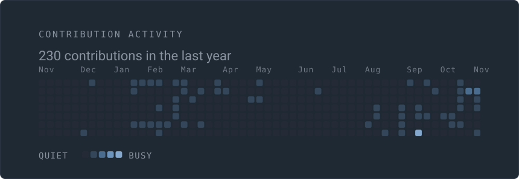

 

I am moving from analytics engineering into AI engineering, in the open. The rule stays
the same as before: if a change cannot be measured, it is not an improvement yet. So every
model call logs its tokens, latency and cost, and every project ships with evals that can
fail the build.

 

### Recent work

<!-- recent starts -->
- [Day 003-004 aieng.text and project exceptions](https://github.com/Seinokojii/ai-engineer-roadmap/commit/520099ad01c86e2b1cdfc3d00aee894f102dcbc0) &nbsp;07 Nov 2026
- [Day 001-002 environment lesson](https://github.com/Seinokojii/ai-engineer-roadmap/commit/ac7701a54cd7b7e744c5a2624e00ec18ebc29e4f) &nbsp;07 Nov 2026
<!-- recent ends -->

 

The full plan, part by part

 

| Block | Days | Covered |
|---|---|---|
| **Foundations** | Days 1-30 | Python for AI code, tokens and sampling, a thin client over local and hosted models, structured output, a review classifier |
| **Evals** | Days 31-50 | Metrics and datasets, LLM-as-judge checked against human labels, error analysis, evals in CI — and evalkit, used by everything after it |
| **Retrieval and RAG** | Days 51-85 | Embeddings, chunking, pgvector, hybrid search and reranking, retrieval and faithfulness evals, incremental indexing |
| **Tools, agents, MCP** | Days 86-110 | Tool calling, an agent loop written by hand, workflows versus agents, an MCP server, agent evals, human-in-the-loop |
| **Production** | Days 111-145 | FastAPI, Docker, fallbacks and rate limits, tracing, caching, cost routing, prompt-injection tests, deploy with an eval gate |
| **Middle level** | Days 146-180 | Quantised local inference, LoRA against a prompting baseline, multimodal extraction, five written system designs |

Three projects instead of ten: a review classifier, an eval harness every later part uses,
and one retrieval product that grows from search to an agent to a deployed service.

 

 

 

Before this: a full analytics engineering pipeline — [live dashboard](https://seinokojii.github.io/analytics-engineer-roadmap/) ·
[dbt docs](https://seinokojii.github.io/analytics-engineer-roadmap/dbt/) · [repository](https://github.com/Seinokojii/analytics-engineer-roadmap).

AI・エンジニア　·　<a href="https://github.com/Seinokojii?tab=repositories">repositories</a>　·　this page rebuilds itself nightly from the GitHub API — <a href="./assets/build.py">assets/build.py</a>
